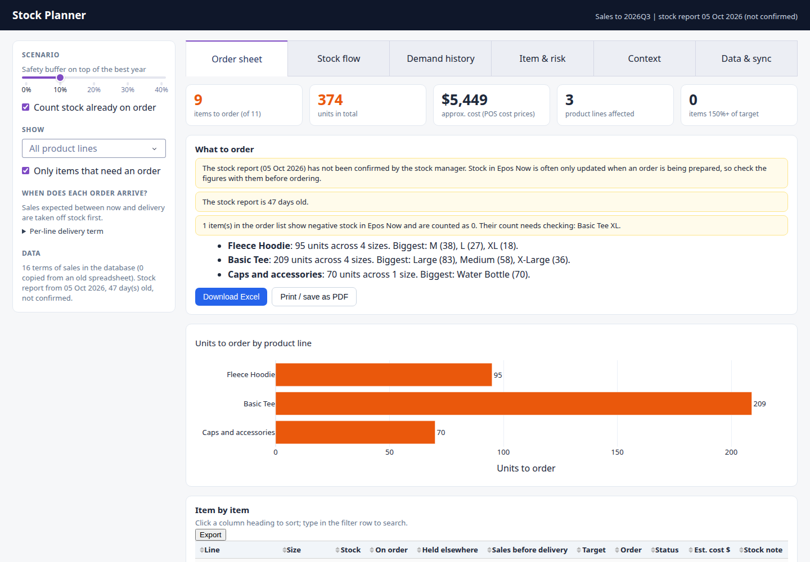

# Stock Order Forecaster

A small, free tool that tells a shop **how many of each item to order**. Give it your quarterly sales
exports and a stock report from your point-of-sale system. It gives back an order quantity for every size
of every product, an interactive dashboard, and an Excel file you can send to whoever places the order.



It was built for a volunteer-run school uniform shop, using **Epos Now** exports. The method is
general, so it works for any small shop whose POS can export "sales by product" and "stock levels" as CSV.

- Dashboard in your web browser (Plotly Dash): order sheet, stock-flow charts, demand history, per-item risk simulation.
- Everything stored in one SQLite file and exportable as plain CSV, so backups can live on a shared drive.
- Optional direct pull from the Epos Now API (needs checking against your own account).
- Free software: GPL-3.0-or-later (see [License](#license)).

**This repository contains only made-up demo data** ("Demo Apparel Co": tees, hoodies, caps). Nothing here comes from a real business.

## Contents
1. [Try it](#1-try-it)
2. [Use your own data](#2-use-your-own-data)
3. [Each quarter](#3-each-quarter)
4. [How the numbers are worked out](#4-how-the-numbers-are-worked-out)
5. [Settings (config.toml)](#5-settings-configtoml)
6. [The database, CSV export and backups](#6-the-database-csv-export-and-backups)
7. [The dashboard tabs](#7-the-dashboard-tabs)
8. [Connecting to Epos Now (optional)](#8-connecting-to-epos-now-optional)
9. [Command line](#9-command-line)
10. [Limitations](#10-limitations)
11. [Checks and releases](#11-checks-and-releases)
12. [Contributing and license](#12-contributing-and-license)

## 1. Try it
1. Install Python 3.11 or newer from <https://www.python.org/downloads/> (Windows: tick "Add python.exe to PATH").
2. Double-click **Start Dashboard.bat** (Windows) or **Start Dashboard.command** (Mac), or run `./start_dashboard.sh` (Linux).
   The first run creates a private environment and installs the add-ons in `requirements.txt`.
3. Your browser opens at `http://127.0.0.1:8050`. The page runs only on your own computer.

Manual setup, if you prefer:

```
python3 -m venv .venv
. .venv/bin/activate          # Windows: .venv\Scripts\activate
pip install -r requirements.txt
python dashboard.py
```

## 2. Use your own data
1. Delete the demo files: everything in `data/sales/` and `data/stock/`, `data/holding.csv`, `data/enrolments.csv`, and `data/stock.db` if it exists.
2. Edit `config.toml`: describe your product lines (Section 5).
3. Start the dashboard and load your files on the **Data & sync** tab (Section 3).

## 3. Each quarter
1. In your POS, export **Sales by Product** for the quarter as CSV (calendar quarters: Q1 Jan-Mar, Q2 Apr-Jun, Q3 Jul-Sep, Q4 Oct-Dec).
   Required columns: `Name`, `Qty`. Optional: `ProductID`, `Barcode`, `Brand`, `OrderCode`, `ValueIncVAT`, `TotCost`. A final `Total:` row is ignored.
2. Open **Data & sync**, choose the year and quarter, drop the file on the sales box. No renaming needed.
   Or from a terminal: `python store.py import-sales FILE.csv 2027Q1`.
3. Export your **stock levels** as CSV (columns `Name`, `MeasuredCurrentStock`/`TotalStock`, `MeasuredOnOrder`, `MeasuredCostPrice`) and drop it on the stock box.
   Keep the name `StockReport_YYYY_MM_DD_HHMM.csv`, since the date is read from it. Tick **Confirmed** if the figures come from a real stocktake.
4. If a supplier holds stock that is not in your POS, edit the **holdings** table (or `data/holding.csv`).
5. Open **Order sheet**.

Loading the same file twice does nothing. Loading a different file for the same quarter replaces that quarter only; the old load stays in the audit log.
A quarter that has not ended yet is treated as partial automatically. Negative stock in the POS is counted as 0 and flagged "check count".

## 4. How the numbers are worked out
- Quarters are grouped into annual periods running Q4 to Q3 (for example 2025Q4 + 2026Q1 + 2026Q2 + 2026Q3).
- **Target** = the best complete year on record x (1 + safety buffer, 10% by default).
- **Stock at delivery** = POS stock + already on order + held elsewhere - sales expected before the order arrives
  (only for lines with a `delivery_quarter`; expected sales come from the same quarters in past years).
- **Suggested order** = max(0, target - stock at delivery).
- **Confidence** = n / (n + 1) for n complete years of history. Fewer years means less certainty, and the dashboard says so.
- A partial period can raise the best-year figure but never lowers it and is never averaged.

The dashboard's risk simulation replays past years with a little random smoothing to show how often a chosen order would have run out.
Use it to compare choices, not as an exact probability.

## 5. Settings (config.toml)
Each product line is a block:

```toml
[[lines]]
name = "Basic Tee"                 # label in the results
match = '^Basic Tee (\S+)$'        # regular expression on the POS product name; the bracket is the size
delivery_quarter = 4               # optional: the quarter the order arrives in
[lines.size_labels]                # optional: friendlier size names
"S" = "Small"
```

An item goes to the first line whose pattern matches. Products that match no line are ignored. Global settings:

| Setting | What it does |
|---|---|
| `buffer_pct = 10` | Safety margin added to the best year |
| `include_on_order = true` | Count stock on order as stock |
| `partial_quarters = []` | Quarters exported before they finished (e.g. `["2026Q4"]`) |
| `backup_dir = ""` | Folder that receives the full CSV export after every load |
| `exclude = ["^total:?$"]` | Product names to ignore |

## 6. The database, CSV export and backups
`data/stock.db` (SQLite, no server needed) holds everything in separate tables: `products`, `terms`, `sales` (one row per product per quarter),
`stock_snapshots`, `stock_levels`, `holdings`, `enrolments`, `annotations` and an `imports` audit log.
Every load is added to it.

**Export:** the **Download full backup** button (Data & sync) or `python store.py export` writes plain CSVs: `sales_history.csv` (the main file),
`stock_levels.csv`, `stock_snapshots.csv`, `holdings.csv`, `enrolments.csv`, `annotations.csv`, `products.csv`, `terms.csv`, `imports.csv`, plus a zip.

**Automatic backup:** set `backup_dir` in `config.toml` to a folder synced to a shared drive (SharePoint, OneDrive, Dropbox...). The export is rewritten there after every load.

**Restore:** on a fresh copy of the program, `python store.py restore EXPORT.zip` rebuilds the database. It refuses to run if a database already exists.

Never put `.env` (your API key) in a backup folder.

## 7. The dashboard tabs
| Tab | Purpose |
|---|---|
| Order sheet | What to order, line by line, with estimated cost. Download Excel / print. |
| Stock flow | Per size: in shop, on order, held elsewhere, less expected sales, against the target. |
| Demand history | Heat map of units by size and quarter, yearly totals, seasonality. |
| Item & risk | One item's history and a simulation of running out for a chosen order size. |
| Context | Headcount/enrolment by group and notes about one-off events (shown on charts). Reporting only; does not change order quantities. |
| Data & sync | Everything loaded, uploads, stock confirmation, holdings, API pull, backups. |

The left panel changes the safety buffer, on-order counting and per-line delivery quarter for "what if" scenarios. Nothing there is saved; edit `config.toml` to make a change permanent.

## 8. Connecting to Epos Now (optional)
Status: tested against a stand-in server only, **not against a live Epos Now account**. Field names in `sync.toml` are best guesses from the public docs.

1. In the Epos Now back office create an API device to get a key and secret (<https://developer.eposnowhq.com/Setup>).
2. Create a `.env` file in this folder with `EPOS_API_KEY=...` and `EPOS_API_SECRET=...`. It is git-ignored. **Never commit or share it.**
3. Run `python sync.py probe` and compare the printed field names with `sync.toml`; edit `sync.toml` if they differ.
4. Check one quarter against a number you trust: `python sync.py sales 2026Q3`.
5. After that: `python sync.py sales 2027Q1` and `python sync.py stock`, or the buttons on the Data & sync tab.

Webhooks (optional, advanced): set `EPOS_WEBHOOK_USER` and `EPOS_WEBHOOK_PASS` in `.env`, run `python dashboard.py --webhook`, and expose `/epos/webhook` through a tunnel. Events are only logged; the pull stays the source for forecasts.

## 9. Command line
```
python forecast.py --only-orders      # print what needs ordering and write output/stock_forecast_latest.xlsx
python store.py status                # what is in the database
python store.py ingest                # load any new CSVs found in data/sales and data/stock
python dashboard.py --port 8051       # choose a port; --no-browser to not open one
```

## 10. Limitations
- The yearly period is fixed at Q4-Q3 and the unit is the calendar quarter. Other fiscal years need a small code change in `forecast.py`.
- Built around the Epos Now CSV layout; other POS exports need the same column names, or a small change in `store.py`.
- The method assumes the best recent year is a good guide to next year. It cannot see one-off changes, which is what the Context notes are for.
- With 3 to 8 years of history, any estimate is rough.
- The Context tab's enrolment grid uses school year levels (Prep, 1-6, Total); edit `YEAR_LEVELS` in `store.py` for other groupings.

## 11. Checks and releases

### Run the checks locally
These are the same commands CI runs (`.github/workflows/ci.yml`). From the project folder, with the environment from Section 1 active:

```
python -m pip install -r requirements.txt
python -m pip install "ruff==0.16.9"      # lint only
ruff check .                              # syntax errors, unused or undefined names (rules in ruff.toml)
python -m unittest discover tests -v      # unit tests
python scripts/smoke_test.py              # forecast on demo data + database CLI + dashboard starts
python scripts/release_tools.py check     # VERSION and CHANGELOG.md agree
```

CI runs the tests on Linux (Python 3.11, 3.12, 3.13), Windows and macOS (3.12), plus the lint and smoke jobs.

### Versioning
[Semantic Versioning](https://semver.org/): `MAJOR.MINOR.PATCH`. While the project is 0.x, minor releases may change behaviour.
The version lives in one place, the **`VERSION`** file. Tags are `v` + that version, for example `v0.2.0`
(`v0.2.0-rc.1` makes a pre-release). Notes for each release are written in `CHANGELOG.md`.

### Make a release
1. Add your changes under `## [Unreleased]` in `CHANGELOG.md` as you merge them.
2. In a pull request, set `VERSION` to the new number, rename `[Unreleased]` content into a new `## [X.Y.Z] - YYYY-MM-DD` section
   with the real date, and leave an empty `## [Unreleased]` above it. Merge it to `main` once CI is green.
3. Tag that commit and push the tag:

   ```
   git switch main && git pull
   git tag -a vX.Y.Z -m "vX.Y.Z"
   git push origin vX.Y.Z
   ```
4. The **Release** workflow re-runs every check, confirms the tag matches `VERSION` and `CHANGELOG.md` and is on `main`,
   then creates the GitHub Release with the changelog text, a `.zip` and `.tar.gz` of the source and `SHA256SUMS.txt`.
   It publishes nothing else and uses no secrets.
5. Open the Release page and check the notes and the three files. To verify a download: `sha256sum -c SHA256SUMS.txt`.

If a release run fails before the release is created, fix the problem on `main`, delete the tag
(`git push --delete origin vX.Y.Z && git tag -d vX.Y.Z`), and tag again.

## 12. Contributing and license
Issues and pull requests are welcome. Please run the checks above first.

### License
Copyright (C) the contributors. This program is free software: you can redistribute it and/or modify it under the terms of the
**GNU General Public License v3.0 or later** (see `LICENSE`). Anyone who distributes a modified version must also make its source available under the same license.
It comes with no warranty. Check suggested quantities before you place an order.
"Epos Now" is a trademark of its owner; this project is not affiliated with or endorsed by Epos Now.
